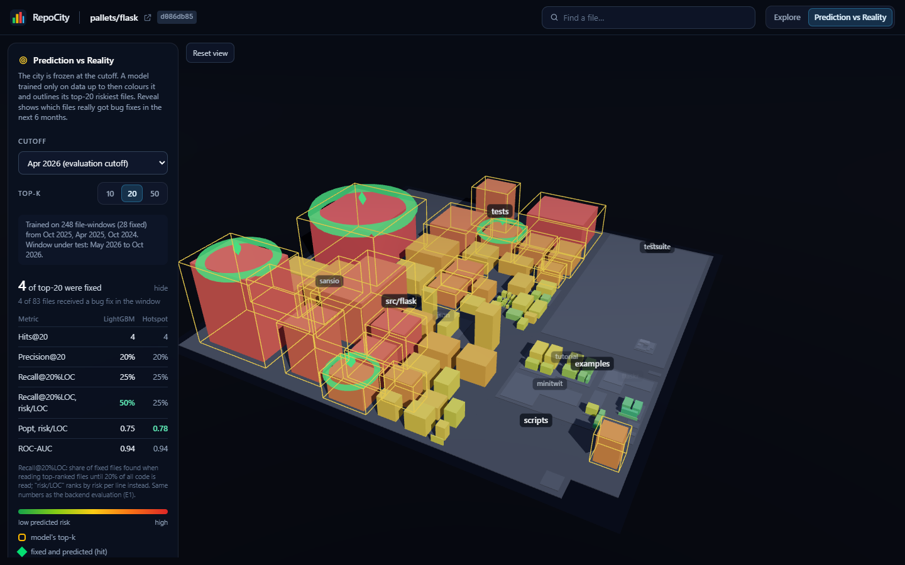
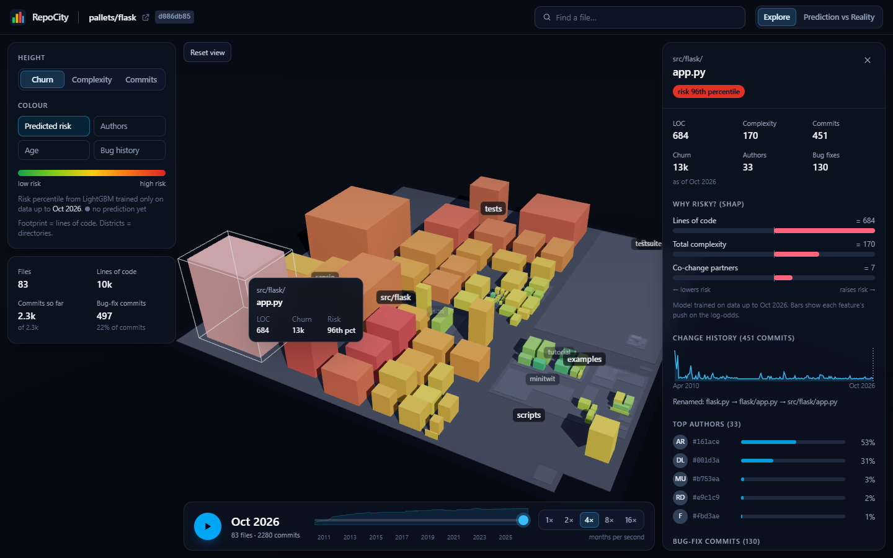

# RepoCity

**RepoCity turns a public git repository into an interactive 3D city and predicts where the bugs will be.**

* Each **source file is a building**, each **directory is a district**.
* **Footprint** = lines of code, **height** = churn (or complexity, or commits), **colour** = predicted bug risk.
* A **time slider** replays the whole history month by month: buildings rise, get demolished, districts form,
  and red sparks show where bugs were born (SZZ).
* A **LightGBM model trained only on the past** flags the files most likely to need bug fixes in the next six months.
* **Prediction vs Reality** freezes the city at a cutoff, outlines the model's top-k risky files, then *reveals*
  which files really were bug-fixed, with a score card against the CodeScene-style hotspot baseline.


| Prediction vs Reality | File panel with SHAP "why risky" |
|---|---|
|  |  |

It is also a research project. Can a process-metric model trained on a repository's own history beat LOC,
churn, hotspot and FixCache baselines, especially under an effort budget, and does it generalise across
projects? See [`reports/report_draft.md`](reports/report_draft.md); every number in it is regenerated by
`python experiments/run_all.py`.

---

## Quick start (Windows, macOS, Linux)

### Option A: Docker Compose (recommended)

Requires [Docker Desktop](https://www.docker.com/products/docker-desktop/).

```bash
docker compose up --build
```

Then open **http://localhost:5173**. The three pre-analysed demo cities (Flask, Express, jsoup) are in
`demo/cache` and work **without internet**. Only the first image build downloads dependencies.

### Option B: natively (Python 3.12 + Node 20+)

```bash
python -m venv .venv
```

```bash
.venv\Scripts\activate
```

(on macOS/Linux: `source .venv/bin/activate`)

```bash
pip install -r backend/requirements-dev.txt
```

```bash
pip install --no-deps -e backend
```

```bash
python -m repocity.cli serve --port 8000
```

In a second terminal:

```bash
cd frontend
```

```bash
npm ci
```

```bash
npm run dev
```

Open **http://localhost:5173**. The Vite dev server proxies `/api` to `http://127.0.0.1:8000`; set
`REPOCITY_API` to point it elsewhere.

`git` must be on the `PATH` (for analysing new repositories).

---

## Using it

1. **Home**: pick a demo city, or paste any public `https://` git URL and press *Build city*. Progress streams
   live (clone → history → snapshots → SZZ → model → layout). A repository with ~3k commits takes about a minute.
2. **City**: drag to orbit, right-drag to pan, scroll to zoom. Hover a building for path, LOC, churn and risk;
   click it for the file panel (metrics, change sparkline, top authors as initials + pseudonymous ids, bug-fix
   commits, SHAP bars, link to GitHub/GitLab). Use **Find a file** to fly to a file.
3. **Encodings** (left): height = churn / complexity / commits; colour = predicted risk / authors / age / bug history.
4. **Timeline** (bottom): drag the slider or press **Space** to play (1×–16× months per second); **←/→** step one month.
5. **Prediction vs Reality** (top right): choose a cutoff and k, then **Reveal reality**. Green diamonds are fixed
   files the model caught, magenta diamonds are fixed files it missed, amber outlines are its top-k.

A 5-minute presenter script is in [`docs/demo_script.md`](docs/demo_script.md).

---

## Repository layout

```
backend/repocity/     ingest/ metrics/ szz/ models/ layout/ api/ store/ pipeline/   (Python package)
backend/tests/        pytest + hypothesis, synthetic git repositories built in fixtures
frontend/src/         city/ timeline/ panels/ modes/ pages/                           (React + three.js)
frontend/e2e/         Playwright end-to-end test (+ FPS benchmark script)
experiments/          configs/ (repos + pinned commits), run_all.py and the E1–E7 stages
reports/              report_draft.md, tables/, figures/, results/ (raw CSV/JSON)
demo/cache/           pre-analysed demo cities (offline)
docs/                 architecture.md, algorithms.md, demo_script.md, screenshots/
```

Read [`docs/architecture.md`](docs/architecture.md) for the system design and
[`docs/algorithms.md`](docs/algorithms.md) for SZZ, FixCache, the treemap, layout stability, features and metrics.

## Tests

```bash
cd backend && pytest
```

```bash
cd frontend && npm test
```

```bash
cd frontend && npx playwright test
```

The Playwright run starts the backend (serving `demo/cache`) and the frontend, opens a demo city, moves the
slider, hovers and clicks a building, searches, switches encodings, runs Prediction vs Reality and checks the
score card against the API. It saves screenshots to `docs/screenshots/`. CI (`.github/workflows/ci.yml`) runs
all three plus `ruff` and `oxlint`, and needs no secrets.

## Reproducing the evaluation

```bash
python experiments/run_all.py
```

This clones the 12 repositories at the commits pinned in `experiments/configs/repos.yaml`, ingests them, runs
E1–E7, rebuilds `demo/cache`, and writes every table and figure into `reports/`. Options: `--reuse-stores`
(skip re-ingestion), `--skip-fps` (no browser benchmark), `--repos flask jsoup` (subset). Seeds are fixed
(`experiments/configs/experiment.yaml`).

The bug-fix heuristic's precision (E6) needs a short manual step: label the 100 commits in
`experiments/spotcheck/bugfix_spotcheck.csv` (column `manual_is_bugfix`, 1 or 0) and re-run.

## Configuration

| Variable | Default | Meaning |
|---|---|---|
| `REPOCITY_DATA_DIR` | `./data` | clones, DuckDB stores, user analyses |
| `REPOCITY_DEMO_DIR` | `./demo/cache` | pre-analysed bundles |
| `REPOCITY_MAX_COMMITS` | 30000 | refuse repositories with more first-parent commits |
| `REPOCITY_MAX_REPO_MB` | 1500 | refuse larger clones |
| `REPOCITY_CLONE_TIMEOUT` | 900 | seconds |
| `REPOCITY_API` | `http://127.0.0.1:8000` | where the frontend proxies `/api` |

Only public repositories over https are supported. No GitHub API or other external service is used, and no
code from analysed repositories is ever executed.
