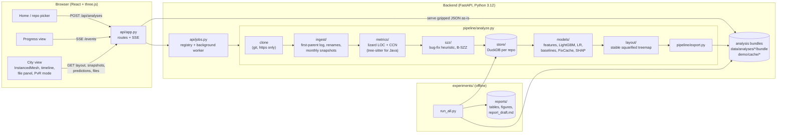

# RepoCity architecture

## Overview



## Components

| Part | Responsibility | Key files |
|---|---|---|
| **Ingestion** | first-parent `git log` parser; rename-aware file identities; monthly snapshots with blob-cached static metrics | `backend/repocity/ingest/history.py`, `ingest/snapshots.py`, `metrics/static.py`, `metrics/java_complexity.py` |
| **Bug data** | keyword bug-fix classifier (merge-aware); B-SZZ with switchable improvements | `szz/bugfix.py`, `szz/szz.py` |
| **Store** | one DuckDB file per repository (commits, changes, files, snapshots, blamed lines) | `store/db.py` |
| **Models** | leakage-free features, labels, LightGBM and logistic regression, 5 baselines (+ ManualUp), FixCache, SHAP, evaluation metrics | `models/features.py`, `models/train.py`, `models/fixcache.py`, `models/evaluation.py` |
| **Layout** | squarified treemap over the union of all files ever seen (stable over time) | `layout/treemap.py` |
| **Export** | writes a *bundle*: gzipped JSON for meta, layout, one file per month, one file per prediction cutoff, commits and per-file details | `pipeline/export.py` |
| **API** | FastAPI routes, background analysis worker (one at a time), SSE progress, URL validation and limits | `api/app.py`, `api/jobs.py` |
| **Frontend** | React + TypeScript + Vite; three.js via @react-three/fiber; Zustand store; Tailwind | `frontend/src/**` |
| **Experiments** | E1–E7, figures, tables, report assembly, demo cache | `experiments/*.py` |

## Data flow of one analysis

1. `POST /api/analyses {url}` validates the URL (https only, no credentials) and asks the remote for its HEAD
   with `git ls-remote`. The analysis id is `<owner>-<repo>-<head[:8]>`. If a bundle with that id exists, it is
   returned immediately (**cache by URL + HEAD**).
2. A background thread clones the repository (full history, no checkout, timeout), checks the size and commit
   limits, and runs the pipeline. Each step emits progress events, which `GET /api/analyses/{id}/events`
   streams as Server-Sent Events.
3. The pipeline writes the DuckDB store, trains models at every 3-month cutoff, computes the layout and exports
   the bundle. The clone is deleted afterwards.
4. The browser loads `meta`, `layout`, the month index and the latest snapshot (the city appears), then
   prefetches the other months in the background, nearest first, for smooth playback.

## Bundle format

```
meta.json.gz                   name, url, head, months, cutoffs, maxima, labels
layout.json.gz                 per building: id, path, x, z, w, d, maxLoc; districts
snapshots/index.json.gz        per month: files, LOC, commits, bug fixes so far
snapshots/YYYY-MM.json.gz      per building arrays: loc, ccn, churn, commits, authors, age,
                               fixes, bugs born, risk percentile
predictions/YYYY-MM.json.gz    risk, risk percentile, hotspot score, actual future fix flags,
                               SHAP top-3, exact rank orders, metrics of all methods
commits.json.gz                compact first-parent commit list
files.json.gz                  per file: changes, path history, SZZ links
```

Per-building arrays are aligned with the `layout.files` order, so the frontend never joins by id. Bundles are
served with `Content-Encoding: gzip` straight from disk, with ETag revalidation. The offline demo cache in
`demo/cache` is just three bundles.

## API

| Method & path | Purpose |
|---|---|
| `GET /api/health` | liveness |
| `GET /api/demo` | pre-analysed demo repositories |
| `POST /api/analyses {url}` | start (or reuse) an analysis → `{id, status}` |
| `GET /api/analyses/{id}` | status (+ meta when done) |
| `GET /api/analyses/{id}/events` | SSE progress stream: clone → history → snapshots → SZZ → model → layout |
| `GET /api/analyses/{id}/layout` | building lots and districts |
| `GET /api/analyses/{id}/snapshots` | months with totals |
| `GET /api/analyses/{id}/snapshots/{YYYY-MM}` | per-building metric arrays |
| `GET /api/analyses/{id}/predictions?cutoff=YYYY-MM` | risk, SHAP, actual future fixes, metrics (without `cutoff`: the list of cutoffs) |
| `GET /api/analyses/{id}/files/{file_id}` | file details (sparkline, authors, bug fixes, SZZ, path history, remote link) |

## Security and limits

* Only `https://host/path` URLs are accepted: no credentials, query strings, `..`, ssh or `file://`.
* Git runs with `GIT_TERMINAL_PROMPT=0`, so private repositories fail fast instead of prompting.
* Nothing from an analysed repository is executed: the code only reads git objects (`log`, `ls-tree`,
  `cat-file`, `blame`, `diff`), and the clone has no checkout.
* Limits (environment variables): `REPOCITY_MAX_COMMITS` (30,000 first-parent commits),
  `REPOCITY_MAX_REPO_MB` (1,500 MB), `REPOCITY_CLONE_TIMEOUT` (900 s). Above 15,000 commits the UI shows a
  "large repository" warning.
* Analysis ids are validated against `^[a-z0-9][a-z0-9._-]*$` before touching the filesystem.

## Deployment

`docker-compose.yml` runs two services:

* **backend**: `python:3.12-slim` + git, uvicorn on port 8000, `demo/cache` mounted read-only, a named volume for
  user analyses.
* **frontend**: a production build served by `vite preview` on port 5173, which proxies `/api` to the backend.

Open http://localhost:5173. Natively, run the same two processes (see README).
