<!-- GENERATED by experiments/make_report.py from experiments/report_template.md. Edit the template, not this file. -->

# RepoCity: Visualising Repository History as a City and Predicting Where Bugs Will Be Fixed

*Capstone project report, draft. All numbers, tables and figures are generated by
`python experiments/run_all.py` from the repositories and commits pinned in `experiments/configs/repos.yaml`.
Sections marked **[TODO: author]** are for the author to write personally.*

---

## Abstract

RepoCity turns any public git repository into an interactive 3D city: files are buildings, directories are
districts, footprint is lines of code, height is churn and colour is predicted bug risk. A time slider replays the
whole history, and a *Prediction vs Reality* mode freezes the city at a cutoff date, shows which files a model trained
only on the past considers risky, then reveals which files actually received bug-fixing commits in the next six months.
Behind the visualisation sits a defect-prediction study on 12 open-source projects in three languages
(39,833 first-parent commits). We compare LightGBM and logistic regression trained on 20 process and
product metrics against five classic baselines (random, LOC, recent churn, a CodeScene-style hotspot score and
FixCache), plus the effort-aware reference ManualUp. On threshold-free ranking metrics, the learned models are
competitive with but **not significantly better than** the strongest simple baseline (file size for ROC-AUC, hotspots for
PR-AUC and precision@k). Under an effort budget, ranking files by predicted risk per line makes the models the best
methods: logistic regression reaches a Recall@20%LOC of 0.351 and Popt of
0.663, significantly better than ManualUp on Popt. Training on the *other* projects
generalises well: cross-project LightGBM reaches a ROC-AUC of 0.818, versus
0.786 within-project. The system analyses a repository with 1.4k–9.4k first-parent commits in under two minutes and
renders 20,000 animated buildings at 60 fps on a desktop GPU.

---

## 1. Introduction

Software teams constantly decide where to spend scarce review and testing effort. Two lines of research address this.
**Software visualisation** helps people understand a large, evolving code base at a glance. CodeCity (Wettel & Lanza,
2007) showed that the *city metaphor* lets developers spot outliers such as huge or frequently changed classes, and
Gource animates a repository's history. **Defect prediction** builds statistical models that rank files by their
likelihood of containing bugs (Zimmermann, Premraj & Zeller, 2007; Hall et al., 2012). The two rarely meet:
visualisations seldom say *where problems will be*, and prediction models are presented as tables that are hard to
trust or inspect.

RepoCity combines them. Its signature feature is a falsifiable, visual experiment: the city is frozen at a cutoff
date, the model's riskiest files are outlined, and then the *actual* future bug fixes are revealed on top.

**Research question.** *Can a process-metric model trained on a repository's own history predict which files will
receive bug-fixing changes in the following six months more accurately, especially under an effort-aware budget,
than classic baselines (LOC, churn, CodeScene-style hotspots and the FixCache/BugCache algorithm)? Does it generalise
across projects and languages?*

We split this into:

* **RQ1 (E1, E2)**: Within a project, do learned models beat the baselines on ranking and effort-aware metrics?
* **RQ2 (E3)**: Which feature groups matter?
* **RQ3 (E4)**: Do models trained on other projects work on an unseen project?
* **RQ4 (E5, E6)**: How sensitive are the results to the quality of the bug labels (SZZ variants, keyword heuristic)?
* **RQ5 (E7)**: Is the system fast enough for interactive use?

**Contributions.** (1) An open, reproducible tool that turns any public git URL into an animated city with live
analysis progress; (2) a leakage-free, time-split evaluation pipeline with five baselines including a re-implementation
of FixCache; (3) an honest empirical result: learned models do *not* dominate simple heuristics on standard ranking
metrics, but do on effort-aware metrics and transfer well across projects.

[TODO: author] *Personal motivation and how the project idea came about.*

## 2. Background and Related Work

**Software visualisation.** CodeCity (Wettel & Lanza, 2007; 2008) maps classes to buildings (height = number of
methods, base = number of attributes) and packages to districts, and showed in a controlled experiment that the
metaphor improves correctness and speed on comprehension tasks. Gource (Caudwell, 2010) animates version-control
history as a growing tree. CodeScene (Tornhill, *Your Code as a Crime Scene*, 2015) popularised **hotspots**: files
that are both complex and frequently changed, rendered as enclosure diagrams. RepoCity borrows the city metaphor and
the history replay, and makes the city *stable over time* so that change can be followed by eye (Section 3.4).

**Defect prediction.** File-level defect prediction ranks files by fault-proneness from product metrics (size,
complexity) and process metrics (churn, number of changes and authors, previous faults). Process metrics are
consistently found to be stronger than code metrics (Moser, Pedrycz & Succi, 2008; Rahman & Devanbu, 2013), and *previous
faults* is one of the strongest single predictors (Ostrand, Weyuker & Bell, 2005). Prediction quality is usually reported
with ROC-AUC; because inspecting a large file costs more than a small one, **effort-aware** evaluation (Mende & Koschke,
2009; 2010; Kamei et al., 2013) charges each file by its size and asks how many defects are found within a budget of
code. Under such evaluation, simply inspecting the smallest files first ("ManualUp") is a surprisingly strong baseline
(Zhou et al., 2018). Cross-project prediction trains on other projects (Zimmermann et al., 2009; Zhang et al., 2016).

**SZZ.** Śliwerski, Zimmermann and Zeller (2005) proposed identifying *bug-introducing* commits by locating bug-fix commits
via their messages and blaming the lines they modified. Later refinements ignore cosmetic changes and comments (Kim et al.,
2006), filter large commits and use issue-report dates (da Costa et al., 2017), and evaluate SZZ's many failure modes
(Rodríguez-Pérez, Robles & González-Barahona, 2018).

**FixCache.** Kim, Zimmermann, Whitehead and Zeller (2007) observed that faults are local in time and space and
proposed *BugCache/FixCache*, which keeps a cache of about 10% of files and loads files on fixes (temporal locality),
together with co-changed files (spatial locality) and new or recently changed files. They reported hit rates of 73–95%.

## 3. Design

### 3.1 Overview

RepoCity has a Python backend (FastAPI, DuckDB, scikit-learn/LightGBM/SHAP) and a React/three.js frontend. An analysis
clones a repository, walks its history, computes monthly snapshots and metrics, finds bug fixes and their origins
(SZZ), trains models at every 3-month cutoff, computes a stable city layout, and exports a compact bundle that the API
serves. The architecture and a diagram are in `docs/architecture.md`; every algorithm is described in plain language in
`docs/algorithms.md`.

### 3.2 Prediction task (time split, no leakage)

For a cutoff month *T*, features use only data up to the end of *T*. A file's label is 1 if a bug-fix commit modifies it
in (*T*, *T* + 6 months]. Only files existing at *T* are included, and file identity follows renames. To predict at *T*,
models are trained on the windows *T* − 6, *T* − 12 and *T* − 18 months, whose labels all end at or before *T*. SZZ-based
features at *T* only use links discovered by fixes before *T*. Two tests prove the absence of leakage: features at *T*
from the full history equal those from a repository truncated at *T*, and perturbing every commit after *T* leaves them
unchanged.

### 3.3 Features, models and baselines

Twenty features in seven groups: size (LOC); complexity (total and maximum cyclomatic complexity, number of functions);
churn (lines changed in the last 3/6/12 months, commits in the last 12 months); people (commits, distinct authors, main
author's share); history (age, days since last change, past bug fixes, SZZ bug-introducing commits); coupling (number of
files the file frequently co-changes with); and directory aggregates. Models: L2-regularised logistic regression on
log-transformed, standardised features, and LightGBM (150 trees of 15 leaves), both with balanced class weights. Per-file
explanations use TreeSHAP. Baselines: random, LOC, recent churn (6 months), hotspot (normalised 12-month revisions ×
normalised complexity) and FixCache with a cache of 10% of files. ManualUp (smallest first) is added as an effort-aware
reference.

### 3.4 City layout

Directories are laid out as a nested squarified treemap (Bruls et al., 2000), with building lots proportional to LOC. To
keep the city stable while the slider moves, the layout is computed **once** from the union of all files that ever
existed. Each file is weighted by its maximum LOC and placed at its latest path, and is hidden while it does not exist.
Buildings therefore never move. The price is empty lots early in history and files drawn at their final location.

### 3.5 Interaction design

[TODO: author] *Design rationale for the encodings, colours and interaction, and any user feedback you collected.*

## 4. Implementation

* **History**: one `git log --first-parent --diff-merges=first-parent -M --raw --numstat` call parses the main-line
  history (Flask: about 1 s); PyDriller serves as a test oracle. File identities follow renames through an
  `IdentityTracker`. Monthly snapshots compute lizard metrics per *blob*, so only changed files are re-parsed. Java
  complexity uses tree-sitter because lizard silently stops parsing some Java files (11 of 131 large files in Commons
  Lang, 12 of 58 in Gson).
* **Bug fixes**: a whole-word keyword heuristic with exclusions (typos, docs, tooling and lint fixes) and vetoes
  (Conventional-Commit `docs:`/`chore:` and dependency bumps). Merges count as fixes if their pull-request title or an
  integrated commit is a fix. Fix commits touching more than 50 files are not counted as fixes.
* **SZZ**: B-SZZ with blame of deleted lines in the fix's parent, plus switchable improvements (whitespace/comments with
  `git blame -w`, large-commit filter, optional issue-date filter).
* **Store/API**: one DuckDB file per repository; FastAPI with Server-Sent Events for progress; heavy work runs in a
  worker subprocess; results are exported as gzipped JSON bundles that are served unchanged.
* **Frontend**: all buildings are one `InstancedMesh`; per-frame exponential smoothing animates height, footprint and
  colour; adaptive quality disables shadows on slow GPUs.
* **Testing**: 12 evaluation repositories are pinned by commit hash. The backend suite builds synthetic git
  repositories with known renames, fixes and bug introductions, and asserts exact SZZ results, labels, the leakage
  properties, FixCache behaviour and treemap invariants (hypothesis). Frontend unit tests cover the data transforms, and
  a Playwright test drives the whole UI and checks that the score card equals the backend's evaluation numbers.

[TODO: author] *Implementation challenges you found most interesting, and what you would do differently.*

## 5. Evaluation

### 5.1 Dataset and setup

Twelve permissively licensed projects, four per language (Python: Flask, Requests, Click, Werkzeug; JavaScript:
Express, Axios, Moment, Mocha; Java: Commons Lang, Commons IO, jsoup, Gson), each with at least 3 years of history and
2–10k commits. Each project is evaluated at six cutoffs, six months apart, covering the last three years whose 6-month
label window is complete. Windows with no positive files have undefined AUCs and are skipped for those metrics. The
models need at least two positive training files, which excludes a few windows, mostly in Moment, which has been in
maintenance mode since 2020. All seeds are fixed.

| repo | language | cutoffs | first_cutoff | last_cutoff | files | positives | train_rows | positive rate |
|---|---|---|---|---|---|---|---|---|
| axios | JavaScript/TypeScript | 6 | 2023-10 | 2026-04 | 168.3 | 30.5 | 442.3 | 18.1% |
| click | Python | 6 | 2023-10 | 2026-04 | 61.0 | 15.5 | 183.2 | 25.4% |
| commons-io | Java | 6 | 2023-10 | 2026-04 | 515.8 | 33.3 | 1472.2 | 6.5% |
| commons-lang | Java | 6 | 2023-10 | 2026-04 | 509.3 | 46.3 | 1462.8 | 9.1% |
| express | JavaScript | 6 | 2023-10 | 2026-04 | 142.0 | 8.5 | 427.5 | 6.0% |
| flask | Python | 6 | 2023-10 | 2026-04 | 82.5 | 10.2 | 243.3 | 12.3% |
| gson | Java | 6 | 2023-10 | 2026-04 | 256.7 | 41.0 | 735.5 | 16.0% |
| jsoup | Java | 6 | 2023-10 | 2026-04 | 164.8 | 47.2 | 446.3 | 28.6% |
| mocha | JavaScript | 6 | 2023-10 | 2026-04 | 423.2 | 19.5 | 1235.2 | 4.6% |
| moment | JavaScript | 6 | 2023-10 | 2026-04 | 619.0 | 13.8 | 1851.0 | 2.2% |
| requests | Python | 6 | 2023-09 | 2026-03 | 35.8 | 2.7 | 106.5 | 7.4% |
| werkzeug | Python | 6 | 2023-10 | 2026-04 | 139.0 | 16.8 | 410.5 | 12.1% |

### 5.2 E1: Within-project prediction (RQ1)

| Method | ROC-AUC | PR-AUC | Recall@20%LOC | Popt | Precision@10 | Precision@20 | Recall@20%LOC (risk/LOC) | Popt (risk/LOC) |
|---|---|---|---|---|---|---|---|---|
| LightGBM | 0.786 ± 0.113 | 0.437 ± 0.212 | 0.183 ± 0.152 | 0.510 ± 0.141 | 0.418 ± 0.280 | 0.349 ± 0.249 | 0.337 ± 0.159 | 0.649 ± 0.117 |
| Logistic regression | 0.793 ± 0.105 | 0.427 ± 0.211 | 0.165 ± 0.152 | 0.500 ± 0.147 | 0.421 ± 0.281 | 0.359 ± 0.256 | 0.351 ± 0.166 | 0.663 ± 0.124 |
| Random | 0.524 ± 0.104 | 0.177 ± 0.126 | 0.200 ± 0.121 | 0.528 ± 0.102 | 0.132 ± 0.140 | 0.131 ± 0.120 | 0.271 ± 0.153 | 0.597 ± 0.123 |
| LOC | 0.803 ± 0.099 | 0.423 ± 0.214 | 0.092 ± 0.096 | 0.394 ± 0.129 | 0.421 ± 0.275 | 0.347 ± 0.240 | 0.214 ± 0.105 | 0.515 ± 0.095 |
| Recent churn | 0.711 ± 0.122 | 0.336 ± 0.211 | 0.206 ± 0.192 | 0.515 ± 0.135 | 0.329 ± 0.257 | 0.292 ± 0.226 | 0.304 ± 0.155 | 0.572 ± 0.131 |
| Hotspot | 0.774 ± 0.115 | 0.431 ± 0.211 | 0.149 ± 0.124 | 0.483 ± 0.123 | 0.436 ± 0.300 | 0.369 ± 0.266 | 0.226 ± 0.145 | 0.547 ± 0.125 |
| FixCache | 0.618 ± 0.082 | 0.239 ± 0.127 | 0.218 ± 0.162 | 0.524 ± 0.119 | 0.301 ± 0.225 | 0.246 ± 0.184 | 0.262 ± 0.150 | 0.537 ± 0.116 |
| ManualUp | 0.197 ± 0.099 | 0.093 ± 0.078 | 0.281 ± 0.171 | 0.606 ± 0.129 | 0.015 ± 0.087 | 0.024 ± 0.071 | 0.281 ± 0.171 | 0.606 ± 0.129 |

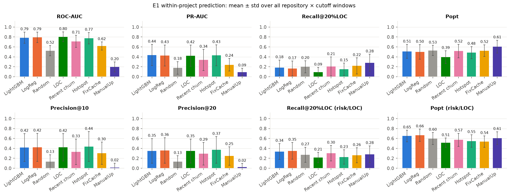

*Figure 1. E1 metrics per method, mean ± std over all repository × cutoff windows.*

**Ranking metrics.** File size alone is a remarkably strong ranking. LOC reaches a ROC-AUC of
0.803, versus 0.786 for LightGBM and
0.793 for logistic regression. The hotspot baseline has the best precision among the top
10 files (0.436). Learned models are in the same group as these baselines but not
above them.

**Effort-aware metrics.** If files are inspected in order of raw risk, every risk-based method spends its 20% LOC budget
on a few large files. The resulting Recall@20%LOC values (LightGBM 0.183,
LOC 0.092) are *below* random (0.200), and ManualUp,
which reads the smallest files first, wins (0.281). This replicates the observation
of Mende & Koschke (2010). Ranking by **predicted risk per line** changes the picture: logistic regression
(0.351) and LightGBM (0.337) find the most
future-fixed files within the budget, ahead of churn (0.304) and ManualUp
(0.281).

> **Transparency note.** The *risk/LOC* ordering was added after the first E1 run showed that probability ranking is
> worse than random on effort-aware metrics. Both orderings are reported for every method, so nothing is hidden. The
> risk/LOC ordering is the standard way to make a classifier effort-aware (Kamei et al., 2013).

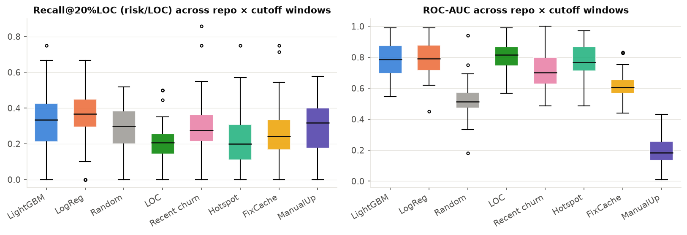

*Figure 2. Distribution over windows: effort-aware Recall@20%LOC (risk/LOC) and ROC-AUC.*

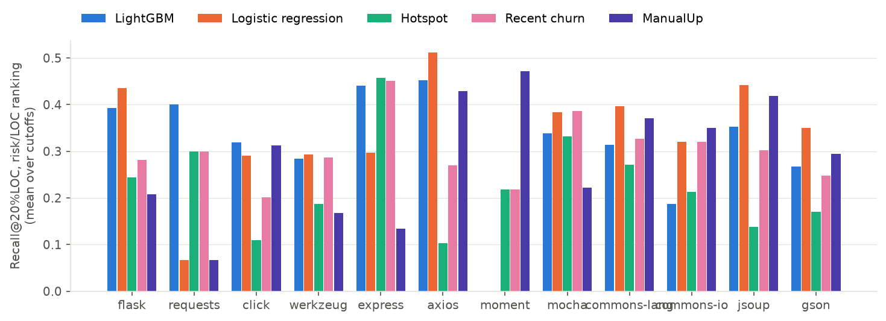

*Figure 3. Effort-aware Recall@20%LOC per repository (mean over cutoffs).*

Per-repository tables for every metric are in `reports/tables/e1_*.md`. The Prediction vs Reality score card in the app
reproduces the same numbers. For the three demo repositories, 384 +
368 + 384 values were checked automatically and all
matched.

### 5.3 E2: Statistical significance

Each (repository, cutoff) window is a paired observation. For every metric we compare each model with **the baseline that
is best on that metric**, chosen on the same data. This favours the baselines, so it is a conservative test for the models.

| Model | Metric | Best baseline | N | Model mean | Baseline mean | W/T/L | Wilcoxon p (Holm) | Cliff's δ |
|---|---|---|---|---|---|---|---|---|
| LightGBM | ROC-AUC | LOC | 61 | 0.786 | 0.807 | 29/1/31 | 0.2964 | -0.105 (negligible) |
| LightGBM | PR-AUC | Hotspot | 61 | 0.437 | 0.456 | 22/0/39 | 0.2375 | -0.080 (negligible) |
| LightGBM | Recall@20%LOC | ManualUp | 61 | 0.183 | 0.284 | 14/8/39 | 0.0097 | -0.381 (medium) |
| LightGBM | Popt | ManualUp | 61 | 0.510 | 0.610 | 16/0/45 | 0.0047 | -0.454 (medium) |
| LightGBM | Precision@10 | Hotspot | 67 | 0.418 | 0.464 | 18/21/28 | 0.0964 | -0.092 (negligible) |
| LightGBM | Precision@20 | Hotspot | 67 | 0.349 | 0.395 | 11/20/36 | 0.0027 | -0.107 (negligible) |
| LightGBM | Recall@20%LOC (risk/LOC) | Recent churn | 61 | 0.337 | 0.306 | 30/11/20 | 0.2964 | +0.123 (negligible) |
| LightGBM | Popt (risk/LOC) | ManualUp | 61 | 0.649 | 0.610 | 29/0/32 | 0.4149 | +0.109 (negligible) |
| Logistic regression | ROC-AUC | LOC | 61 | 0.793 | 0.807 | 27/1/33 | 0.1709 | -0.076 (negligible) |
| Logistic regression | PR-AUC | Hotspot | 61 | 0.427 | 0.456 | 23/0/38 | 0.1330 | -0.091 (negligible) |
| Logistic regression | Recall@20%LOC | ManualUp | 61 | 0.165 | 0.284 | 12/8/41 | 0.0013 | -0.455 (medium) |
| Logistic regression | Popt | ManualUp | 61 | 0.500 | 0.610 | 18/0/43 | 0.0033 | -0.463 (medium) |
| Logistic regression | Precision@10 | Hotspot | 67 | 0.421 | 0.464 | 12/27/28 | 0.0924 | -0.084 (negligible) |
| Logistic regression | Precision@20 | Hotspot | 67 | 0.359 | 0.395 | 12/24/31 | 0.0466 | -0.093 (negligible) |
| Logistic regression | Recall@20%LOC (risk/LOC) | Recent churn | 61 | 0.351 | 0.306 | 40/6/15 | 0.1052 | +0.275 (small) |
| Logistic regression | Popt (risk/LOC) | ManualUp | 61 | 0.663 | 0.610 | 49/0/12 | 0.0000 | +0.248 (small) |

| Metric | N | LightGBM | Logistic regression | Random | LOC | Recent churn | Hotspot | FixCache | ManualUp | Friedman p | Nemenyi CD |
|---|---|---|---|---|---|---|---|---|---|---|---|
| ROC-AUC | 61 | 2.94* | 2.80* | 6.61 | 2.66* | 4.28 | 2.77* | 5.95 | 8.00 | 2.3e-63 | 1.34 |
| PR-AUC | 61 | 3.00* | 3.07* | 6.61 | 2.98* | 4.30 | 2.42* | 5.62 | 8.00 | 9.5e-60 | 1.34 |
| Recall@20%LOC | 61 | 4.55 | 4.77 | 3.80* | 6.70 | 4.43 | 5.20 | 3.73* | 2.84* | 3.8e-20 | 1.34 |
| Popt | 61 | 4.41 | 4.57 | 3.95* | 7.05 | 4.31 | 4.90 | 4.00* | 2.80* | 2.5e-19 | 1.34 |
| Precision@10 | 67 | 3.39* | 3.56* | 6.42 | 3.27* | 4.44 | 2.86* | 4.64 | 7.43 | 4.3e-50 | 1.28 |
| Precision@20 | 67 | 3.52* | 3.25* | 6.44 | 3.30* | 4.30 | 2.56* | 5.06 | 7.57 | 1.9e-56 | 1.28 |
| Recall@20%LOC (risk/LOC) | 61 | 3.95* | 2.80* | 4.42 | 5.80 | 4.31 | 5.56 | 5.12 | 4.05* | 2.4e-13 | 1.34 |
| Popt (risk/LOC) | 61 | 3.52* | 2.51* | 3.97 | 6.25 | 5.08 | 5.23 | 5.69 | 3.75* | 2.5e-21 | 1.34 |

Read together: on ROC-AUC, PR-AUC and precision@k the models are statistically indistinguishable from, or slightly worse
than, the best baseline (negligible effect sizes), and several baselines share the top Nemenyi group. On raw effort-aware
metrics ManualUp is significantly better. With risk/LOC ranking, logistic regression is the best-ranked method on both
effort-aware metrics and significantly better than ManualUp on Popt (Holm-corrected p =
0.0000, Cliff's δ = +0.248, small). LightGBM's
effort-aware advantage is not significant.

**Answer to RQ1.** *Partly.* A model trained on a project's own history does not beat the simple heuristics practitioners
already use for "which files are risky?" rankings. It does give the best effort-aware rankings once risk is normalised by
size, significantly so for logistic regression on Popt. The simpler, interpretable logistic regression is at least as good
as LightGBM, which is plausible given only a few hundred training files per project.

### 5.4 E3: Feature-group ablation (RQ2)

| Removed group | N | Δ Recall@20%LOC | p | Δ Recall@20%LOC (risk/LOC) | p (risk/LOC) | Δ ROC-AUC |
|---|---|---|---|---|---|---|
| size | 61 | +0.019 ± 0.084 | 0.158 | +0.016 ± 0.057 | 0.026 | +0.001 ± 0.031 |
| complexity | 61 | +0.004 ± 0.091 | 0.896 | +0.007 ± 0.075 | 0.556 | -0.002 ± 0.025 |
| churn | 61 | +0.003 ± 0.108 | 0.587 | +0.009 ± 0.101 | 0.222 | +0.003 ± 0.025 |
| people | 61 | +0.014 ± 0.092 | 0.962 | +0.010 ± 0.076 | 0.075 | -0.004 ± 0.023 |
| history | 61 | -0.013 ± 0.065 | 0.120 | +0.018 ± 0.126 | 0.225 | -0.005 ± 0.034 |
| coupling | 61 | +0.003 ± 0.045 | 0.989 | +0.007 ± 0.051 | 0.309 | +0.001 ± 0.018 |
| directory | 61 | +0.010 ± 0.089 | 0.993 | +0.002 ± 0.083 | 0.489 | -0.006 ± 0.038 |

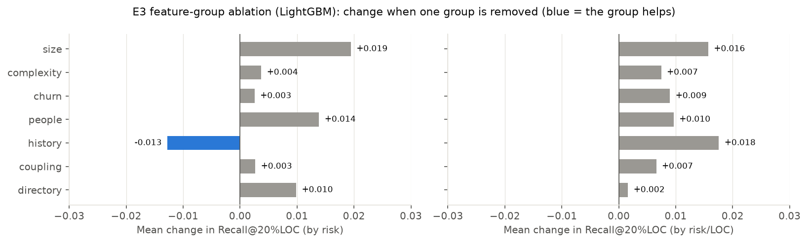

*Figure 4. Change in Recall@20%LOC when one feature group is removed (blue = removing it hurts).*

No single group is indispensable: removing any one group changes recall by at most about two percentage points,
far less than the window-to-window spread. The one change with p < 0.05 is that removing the **size** group *raises*
effort-aware recall (+0.016, p = 0.026; raw ranking
+0.019, p = 0.158). These p-values are uncorrected across 14 tests, so this is at
most weak evidence. It is plausible, though: size pushes large files up the ranking, which is exactly what effort-aware
evaluation penalises. The features are highly redundant (churn, commits and past fixes are strongly correlated), so the
model compensates when one group is missing. Removing *history* (past fixes, SZZ) is the only change that lowers raw
recall on average (-0.013).

### 5.5 E4: Cross-project generalisation (RQ3)

Leave-one-project-out: for each held-out project and cutoff, LightGBM is trained on the other projects' windows that end
at or before the cutoff, with features converted to percentile ranks per (project, window).

| Held-out repository | N | ROC-AUC within | ROC-AUC cross | Recall@20%LOC (risk/LOC) within | Recall@20%LOC (risk/LOC) cross | Popt (risk/LOC) within | Popt (risk/LOC) cross |
|---|---|---|---|---|---|---|---|
| flask | 6 | 0.866 | 0.906 | 0.393 | 0.404 | 0.714 | 0.651 |
| requests | 5 | 0.899 | 0.940 | 0.400 | 0.167 | 0.739 | 0.523 |
| click | 5 | 0.828 | 0.838 | 0.320 | 0.331 | 0.659 | 0.698 |
| werkzeug | 6 | 0.865 | 0.881 | 0.284 | 0.261 | 0.582 | 0.578 |
| express | 4 | 0.797 | 0.870 | 0.441 | 0.403 | 0.695 | 0.699 |
| axios | 6 | 0.742 | 0.768 | 0.453 | 0.493 | 0.724 | 0.763 |
| mocha | 5 | 0.855 | 0.842 | 0.338 | 0.399 | 0.647 | 0.700 |
| commons-lang | 6 | 0.740 | 0.774 | 0.314 | 0.387 | 0.616 | 0.676 |
| commons-io | 6 | 0.651 | 0.716 | 0.187 | 0.295 | 0.558 | 0.622 |
| jsoup | 6 | 0.716 | 0.758 | 0.353 | 0.410 | 0.666 | 0.732 |
| gson | 6 | 0.723 | 0.749 | 0.267 | 0.328 | 0.572 | 0.621 |
| **all (pooled)** | 61 | 0.786 | 0.818 | 0.337 | 0.354 | 0.649 | 0.660 |
| Wilcoxon p (pooled) |  |  | 0.002 |  | 0.259 |  | 0.063 |

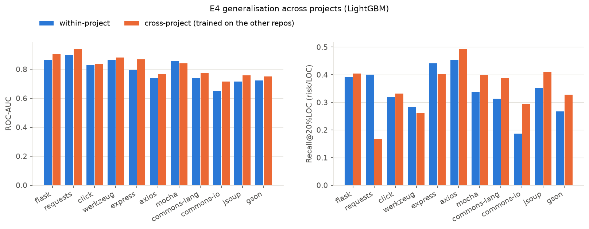

*Figure 5. Within-project vs cross-project LightGBM.*

**Answer to RQ3.** Yes. Cross-project models are at least as good as within-project ones: pooled ROC-AUC rises from
0.786 to 0.818 (Wilcoxon p = 0.002),
and effort-aware recall is statistically unchanged (0.337 vs
0.354). For effort-aware recall the gains are concentrated in the four Java
projects, while the small Requests project loses. The likely reason for the overall gain is data volume:
a single project contributes a few hundred labelled files per window, the pooled training set many thousands. A practical
consequence is that RepoCity could ship a pre-trained cross-project model for young repositories with little history.

### 5.6 E5: SZZ ablation (RQ4)

| SZZ variant | Links (fix, file, intro) | Distinct introducing commits | Fixes with ≥1 link | LightGBM Recall@20%LOC | LightGBM ROC-AUC |
|---|---|---|---|---|---|
| B-SZZ | 35081 | 12634 | 73.6% | 0.180 | 0.782 |
| +ws/comments | 31040 | 11462 | 68.4% | 0.185 | 0.786 |
| +large commits | 24349 | 10949 | 69.9% | 0.181 | 0.783 |
| +both (default) | 21473 | 9853 | 65.2% | 0.183 | 0.786 |
| issue-date filter | not applicable | no issue-tracker dates (no external APIs) |  |  |  |

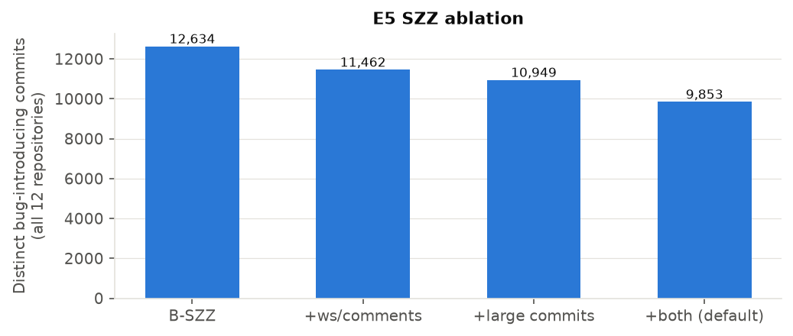

*Figure 6. Distinct bug-introducing commits identified by each SZZ variant.*

The improvements matter for the *bug-origin* data: ignoring whitespace/comment lines and large commits removes
12634 − 9853 candidate introducing commits. They barely matter for
prediction: the SZZ count is one feature among twenty, and past *fixes* already carry most of its signal. The issue-date
filter could not be evaluated, because RepoCity deliberately uses no issue-tracker API.

### 5.7 E6: Quality of the bug-fix heuristic (RQ4)

`experiments/spotcheck_bugfix.py` sampled 100 commits (50 each from Flask and Commons Lang, half flagged as fixes) into
`experiments/spotcheck/bugfix_spotcheck.csv` for manual labelling. Status: **pending**.

[TODO: author] *Label the 100 commits (column `manual_is_bugfix`), re-run `python experiments/run_all.py --reuse-stores`,
and report the precision and its 95% Wilson interval from `reports/results/e6_spotcheck.json` here.*

During development, inspecting the largest flagged commits revealed systematic false positives (tooling fixes such as
"Fix Checkstyle errors", reformatting, dependency bumps). They led to the exclusion list and the 50-file limit for fixes,
both documented in `docs/algorithms.md`.

### 5.8 E7: System performance (RQ5)

| Repository | First-parent commits | Files (last month) | File identities | Ingest (s) | Models + export (s) | Total (s) | Peak RSS (MB) |
|---|---|---|---|---|---|---|---|
| axios | 1893 | 264 | 397 | 22.5 | 5.8 | 28.2 | 1557 |
| click | 1384 | 91 | 111 | 12.3 | 5.2 | 17.5 | 1581 |
| commons-io | 5844 | 556 | 657 | 41.6 | 15.6 | 57.2 | 1761 |
| commons-lang | 9397 | 628 | 1125 | 90.3 | 18.8 | 109.1 | 1869 |
| express | 3911 | 141 | 356 | 22.7 | 8.0 | 30.7 | 1551 |
| flask | 2280 | 83 | 170 | 15.7 | 7.2 | 22.8 | 1589 |
| gson | 2058 | 264 | 532 | 25.2 | 10.6 | 35.8 | 1636 |
| jsoup | 2362 | 205 | 273 | 25.4 | 8.5 | 33.8 | 1666 |
| mocha | 3142 | 478 | 613 | 26.2 | 9.2 | 35.4 | 1600 |
| moment | 1763 | 634 | 832 | 32.5 | 10.1 | 42.6 | 1629 |
| requests | 2669 | 37 | 274 | 14.9 | 6.2 | 21.2 | 1581 |
| werkzeug | 3130 | 143 | 291 | 29.9 | 11.2 | 41.1 | 1645 |

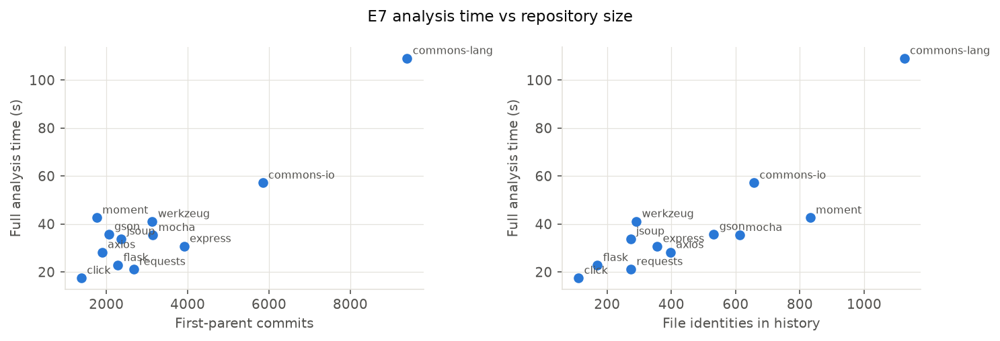

*Figure 7. Full analysis time (ingest + models + export) against repository size.*

All 12 repositories were analysed in 359 s of ingestion in total. Analysis
time grows roughly linearly with history length; the largest project (Commons Lang, 9.4k first-parent commits) takes under
two minutes. Peak memory (about 1869 MB) is dominated by the parallel metric workers.

| Endpoint | p50 latency (ms) | p95 latency (ms, worst demo repo) | Response size (KB, gzip) |
|---|---|---|---|
| GET /demo | 1.0 | 1.5 | 0.9 |
| GET file detail | 0.8 | 1.4 | 6.9 |
| GET layout | 0.7 | 1.2 | 30.3 |
| GET meta | 0.6 | 1.2 | 9.2 |
| GET predictions | 0.7 | 1.1 | 23.7 |
| GET snapshot | 0.7 | 1.2 | 9.0 |

Because bundles are pre-gzipped files served as-is, every endpoint answers in about a millisecond on localhost.

| Buildings | GPU, vsync: median FPS | GPU, uncapped: median FPS | CPU only (SwiftShader): median FPS | JS update per frame (ms) |
|---|---|---|---|---|
| 1000 | 60.0 | 4800.5 | 18.0 | 0.0 |
| 2500 | 60.0 | 3089.0 | 12.2 | 0.1 |
| 5000 | 60.0 | 1899.0 | 8.3 | 0.4 |
| 10000 | 60.0 | 1101.1 | 5.3 | 0.6 |
| 20000 | 60.0 | 583.5 | 3.4 | 1.3 |

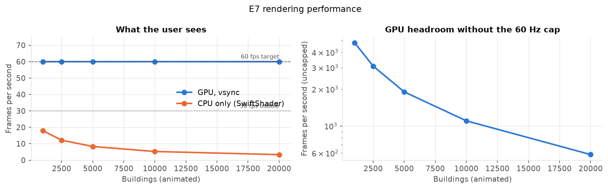

*Figure 8. Frame rate with all buildings animating.*

On the development machine's GPU, the city holds the display's 60 fps up to 20,000 animated buildings, with large
headroom when the frame cap is removed. The JavaScript update loop costs about a millisecond per frame at 20k buildings.
**Limitation:** this is a desktop GPU, not the "normal laptop" of the requirement. With pure CPU rendering (SwiftShader),
the frame rate drops to single digits beyond a few thousand buildings, so machines without a usable GPU are a real limit.
The adaptive-quality mode (no shadows, pixel ratio 1) helps, but does not close the gap. [TODO: author] *Measure on your
laptop with `node frontend/e2e/fps-bench.mjs` (see README) and add the numbers here.*

### 5.9 The tool

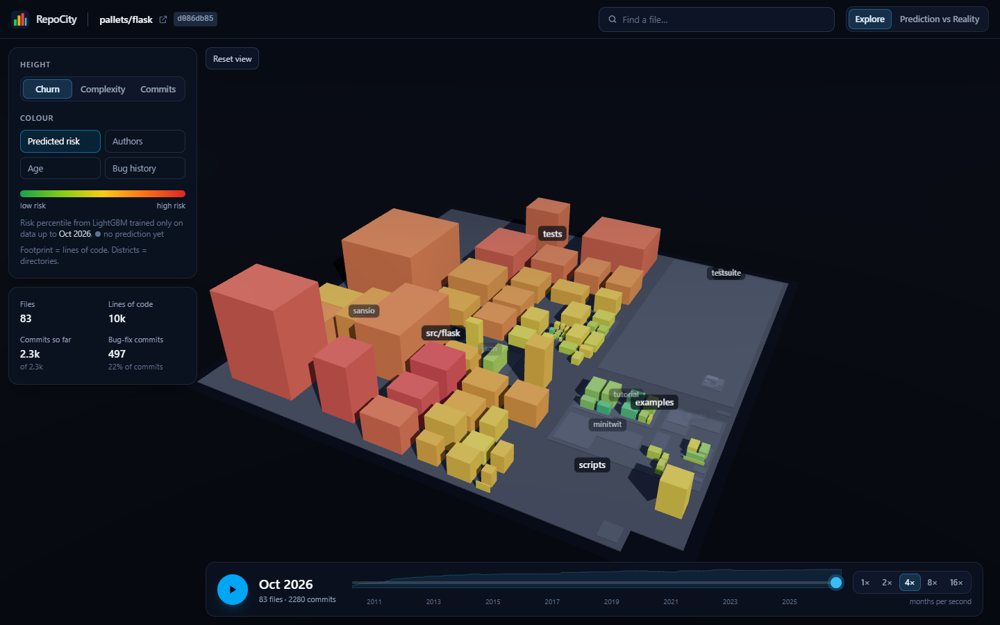

*Figure 9. Flask in October 2026. Height = churn, colour = predicted risk percentile.*

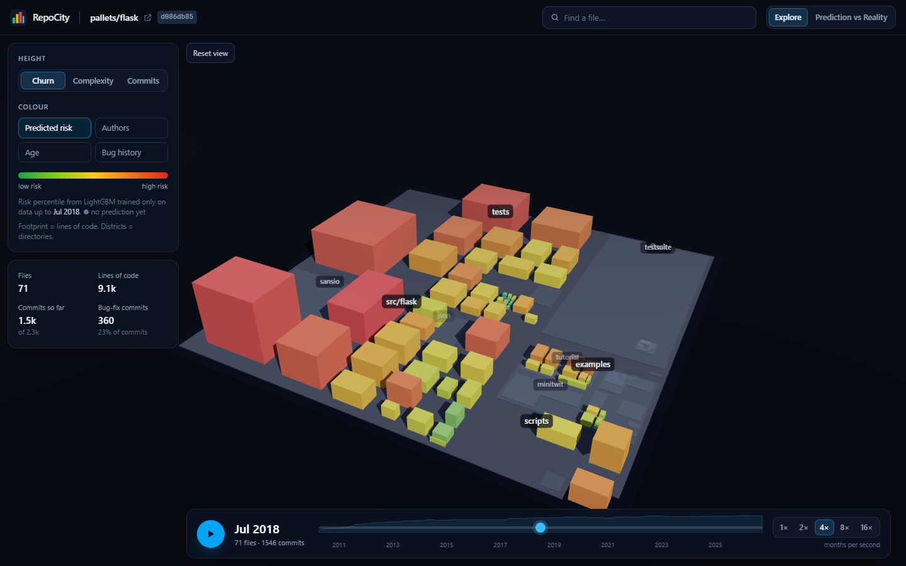

*Figure 10. The same city half-way through its history: buildings that do not exist yet are hidden, the layout does not move.*

*Figure 11. File panel: metrics, change history, SHAP explanation, authors (pseudonymous) and bug fixes.*

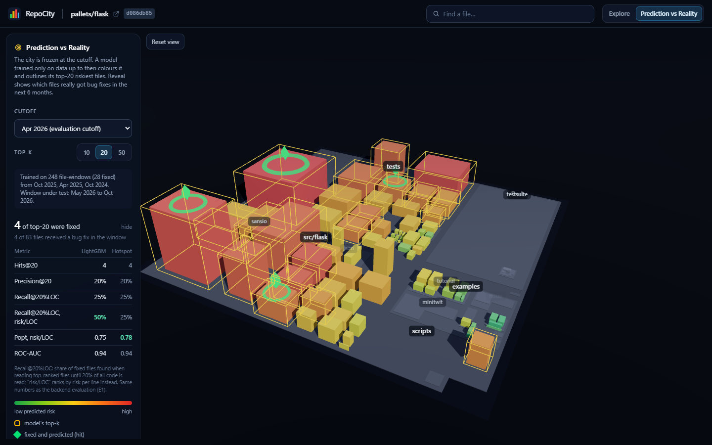

*Figure 12. Prediction vs Reality after the reveal: amber = top-20 predicted, green diamond = predicted and fixed, magenta = fixed but missed.*

## 6. Threats to Validity

**Construct validity.**
*Keyword heuristic noise.* Bug fixes are identified from commit messages without an issue tracker. Messages such as "fix typo"
or "Fix Checkstyle errors" are excluded, but false positives (refactorings described as fixes) and false negatives (fixes
described without keywords) remain. E6 quantifies this once the manual labels are complete. Tangled commits that fix a bug
and also refactor add label noise at file level.
*SZZ limitations.* B-SZZ cannot blame lines for fixes that only add code. The last change to a line is not necessarily the
change that introduced the bug, and blame can attribute lines to refactorings or merges (Rodríguez-Pérez et al., 2018). In
RepoCity, SZZ feeds one feature and the visualisation; E5 shows the prediction results are insensitive to the variant.
*Label time window.* A file is labelled by bug fixes in a fixed six-month window. A defect present at *T* but fixed after
*T* + 6 months counts as a negative, and recent windows can contain bugs that have not been found yet. Different horizons
could change absolute numbers.
*Effort proxy.* LOC is used as the inspection effort, which ignores that some code is harder to read than other code.

**Internal validity.** Features and labels are separated in time, and leakage is tested. Hyperparameters were fixed
in advance and not tuned on the evaluation windows. The *risk/LOC* ordering was added after seeing E1 results; both
orderings are reported to avoid selective reporting. The 50-file limit and the exclusion list were developed by inspecting
flagged commits in the evaluated projects, which may make the heuristic slightly optimistic for these projects. The
manual spot-check sample is drawn after these changes.

**External validity (project selection bias).** Twelve popular, well-maintained libraries with disciplined commit messages
are not representative of industrial or application code. Projects were selected for being active in the last three years,
which excludes dormant projects. Within-project evaluation windows contain from tens to hundreds of files, so per-window
metrics are noisy (see the standard deviations).

**Conclusion validity.** With 61–67 paired windows, Wilcoxon tests have moderate power. Effect sizes are reported alongside
p-values, and Holm correction is applied across metrics. Windows from the same project are not independent.

## 7. Conclusion and Future Work

RepoCity shows a repository's entire history as a city that can be explored, replayed and questioned. Its Prediction vs
Reality mode makes a defect-prediction model's claims directly falsifiable on screen. The empirical answer to the
research question is nuanced. Within a project, learned models do **not** beat the best simple heuristics on standard
ranking metrics: file size and CodeScene-style hotspots are hard to beat. Under an effort budget, ranking by predicted risk
per line makes the learned models (especially logistic regression) the best choice. Models trained on other projects
generalise as well as or better than within-project models.

Future work: (1) calibrated, effort-aware training objectives instead of post-hoc risk/LOC; (2) a bundled cross-project
model for young repositories; (3) issue-tracker integration where available, for issue-linked labels and the MA-SZZ date
filter; (4) a user study of the city metaphor for code review planning; (5) WebGPU rendering and level-of-detail for
weak hardware.

[TODO: author] *Personal reflection: what you learned, what surprised you, and what you would do differently.*

## References

* Bruls, M., Huizing, K., van Wijk, J. J. (2000). Squarified Treemaps. *Data Visualization (Proc. VisSym)*.
* Caudwell, A. H. (2010). Gource: visualizing software version control history. *SPLASH Companion*.
* da Costa, D. A., McIntosh, S., Shang, W., Kulesza, U., Coelho, R., Hassan, A. E. (2017). A Framework for Evaluating the Results of the SZZ Approach for Identifying Bug-Introducing Changes. *IEEE TSE* 43(7).
* Demšar, J. (2006). Statistical Comparisons of Classifiers over Multiple Data Sets. *JMLR* 7.
* Hall, T., Beecham, S., Bowes, D., Gray, D., Counsell, S. (2012). A Systematic Literature Review on Fault Prediction Performance in Software Engineering. *IEEE TSE* 38(6).
* Kamei, Y., Shihab, E., Adams, B., Hassan, A. E., Mockus, A., Sinha, A., Ubayashi, N. (2013). A large-scale empirical study of just-in-time quality assurance. *IEEE TSE* 39(6).
* Ke, G., et al. (2017). LightGBM: A Highly Efficient Gradient Boosting Decision Tree. *NeurIPS*.
* Kim, S., Zimmermann, T., Pan, K., Whitehead, E. J. (2006). Automatic Identification of Bug-Introducing Changes. *ASE*.
* Kim, S., Zimmermann, T., Whitehead, E. J., Zeller, A. (2007). Predicting Faults from Cached History. *ICSE*.
* Lundberg, S. M., et al. (2020). From local explanations to global understanding with explainable AI for trees. *Nature Machine Intelligence* 2.
* McCabe, T. J. (1976). A Complexity Measure. *IEEE TSE* SE-2(4).
* Mende, T., Koschke, R. (2009). Revisiting the evaluation of defect prediction models. *PROMISE*.
* Mende, T., Koschke, R. (2010). Effort-Aware Defect Prediction Models. *CSMR*.
* Mockus, A., Votta, L. G. (2000). Identifying Reasons for Software Changes Using Historic Databases. *ICSM*.
* Moser, R., Pedrycz, W., Succi, G. (2008). A comparative analysis of the efficiency of change metrics and static code attributes for defect prediction. *ICSE*.
* Ostrand, T. J., Weyuker, E. J., Bell, R. M. (2005). Predicting the location and number of faults in large software systems. *IEEE TSE* 31(4).
* Rahman, F., Devanbu, P. (2013). How, and why, process metrics are better. *ICSE*.
* Rodríguez-Pérez, G., Robles, G., González-Barahona, J. M. (2018). Reproducibility and credibility in empirical software engineering: A case study based on a systematic literature review of the use of the SZZ algorithm. *IST* 99.
* Romano, J., Kromrey, J. D., Coraggio, J., Skowronek, J. (2006). Appropriate statistics for ordinal level data. *Annual meeting of the Florida Association of Institutional Research*.
* Śliwerski, J., Zimmermann, T., Zeller, A. (2005). When Do Changes Induce Fixes? *MSR*.
* Tornhill, A. (2015). *Your Code as a Crime Scene*. Pragmatic Bookshelf.
* Wettel, R., Lanza, M. (2007). Visualizing Software Systems as Cities. *VISSOFT*.
* Wettel, R., Lanza, M., Robbes, R. (2011). Software systems as cities: a controlled experiment. *ICSE*.
* Zhang, F., Zheng, Q., Zou, Y., Hassan, A. E. (2016). Cross-project defect prediction using a connectivity-based unsupervised classifier. *ICSE*.
* Zhou, Y., Yang, Y., Lu, H., Chen, L., Li, Y., Zhao, Y., Qian, J., Xu, B. (2018). How Far We Have Progressed in the Journey? Examining Cross-Project Defect Prediction. *ACM TOSEM* 27(1).
* Zimmermann, T., Premraj, R., Zeller, A. (2007). Predicting Defects for Eclipse. *PROMISE*.
* Zimmermann, T., Nagappan, N., Gall, H., Giger, E., Murphy, B. (2009). Cross-project defect prediction. *ESEC/FSE*.

*Reproduce everything with `python experiments/run_all.py`. Raw results: `reports/results/`.*
